<!-- ================= 🍔 EAT · 😴 SLEEP · 💻 CODE · 🔁 REPEAT ================= -->
<p align="center">
  
</p>

<h2 align="center">🍔 𝗘𝗔𝗧 &nbsp;·&nbsp; 😴 𝗦𝗟𝗘𝗘𝗣 &nbsp;·&nbsp; 💻 𝗖𝗢𝗗𝗘 &nbsp;·&nbsp; 🔁 𝗥𝗘𝗣𝗘𝗔𝗧</h2>

<p align="center">
  
</p>

<!-- ================= HEADER ================= -->
<p align="center">
  
</p>

<p align="center">
  
</p>

<p align="center">
  <a href="https://linkedin.com/in/connectbharath"></a>
  <a href="https://itsbharathportfolio.netlify.app"></a>
  <a href="https://github.com/PreciousBharath"></a>
  
</p>

---

## 👨‍💻 About Me

```python
class Bharath:
    role      = ["Software Developer", "Project Engineer", "Technical Trainer"]
    company   = "Pantech Solutions"
    location  = "Madurai, Tamil Nadu, India"

    expertise = {
        "AI & Data"   : ["Machine Learning", "Deep Learning", "Generative AI", "Prompt Engineering"],
        "Data Science": ["Python", "NumPy", "Pandas", "Matplotlib", "Data Analysis"],
        "BI Tools"    : ["Power BI", "Tableau"],
        "Development" : ["Python Full Stack", "Frontend Development"],
        "Emerging"    : ["Cloud Computing", "Blockchain", "Cybersecurity"],
    }

    def motto(self):
        return "Learn it. Build it. Teach it."
```

- 💼 **Software Developer & Project Engineer** building AI/ML, data and full-stack solutions
- 🎓 **Technical Trainer** for students and faculty across AI/ML, GenAI, Data Analysis, Cloud, Blockchain and Cybersecurity
- 🤖 Built **ML & deep-learning projects** for healthcare, agriculture, cybersecurity and e-commerce
- 📫 Reach me on **[LinkedIn](https://linkedin.com/in/connectbharath)**

---

## 🛠️ Skills & Tech Stack

**🤖 AI, Machine Learning & Deep Learning**
<p>
  
  
  
  
  
  
</p>

**📊 Data Science, Analysis & BI**
<p>
  
  
  
  
  
  
  
</p>

**🌐 Python Full Stack & Frontend**
<p>
  
  
  
  
  
</p>

**☁️ Cloud, Blockchain & Security**
<p>
  
  
  
</p>

**🧰 Tools & Deployment**
<p>
  
  
  
  
  
</p>

---

## 🚀 Featured Projects

### 🤖 AI / Machine Learning
| Project | What it does | Stack |
|---|---|---|
| [🎙️ Voice Emotion Detection](https://github.com/PreciousBharath/VOICE-EMOTION-DETECTION) | Predicts emotions (happy, sad, angry) from speech | Python · ML · HTML |
| [🛡️ URL Phishing Detection](https://github.com/PreciousBharath/URL-PHISING) | Classifies malicious phishing URLs | Python · ML |
| [📰 Fake News Detection](https://github.com/PreciousBharath/FAKE-NEWS-DETECTION) | Flags fake vs. real news articles with NLP | Python · NLP |
| [🌾 Smart Crop Agriculture](https://github.com/PreciousBharath/SMART-CROP-AGRICULTURE) | Recommends crops from soil conditions | Python · ML |
| [💧 Water Potability](https://github.com/PreciousBharath/WATER-PROTABILITY) | Predicts whether water is safe to drink | Python · ML |
| [👩 Women Safety Risk Areas](https://github.com/PreciousBharath/WOMEN-SAFETY) | Predicts high-risk areas for women's safety | Python · ML |
| [🎬 Box Office Prediction](https://github.com/PreciousBharath/BOX-OFFICE-PREDICTION) | Forecasts movie revenue | Python · Regression |
| [☀️ Solar Energy Prediction](https://github.com/PreciousBharath/SOLAR-ENERGY-PREDICTION) | Predicts solar energy consumption | Python · ML |

### 🌐 Full-Stack & Web Apps
| Project | What it does | Stack |
|---|---|---|
| [📚 E-Learning Platform](https://github.com/PreciousBharath/my-project-e-learn) · [Live ↗](https://my-project-e-learn.vercel.app) | Learning portal for JEE, GATE & computer courses | HTML · JS · Vercel |
| [🔐 Cyber Security Awareness Test](https://github.com/PreciousBharath/DJANGO-CYBER-SECURITY-AWARNESS-TEST) | Full-stack quiz app for security awareness | Django · Python |
| [📄 Resume Builder](https://github.com/PreciousBharath/RESUME-BUILDER) | Generates professional resumes | Python |
| [✈️ Travel Planner](https://github.com/PreciousBharath/TRAVEL-PLANNER) | Plans tourist trips and itineraries | JavaScript |
| [🏥 Hospital Management](https://github.com/PreciousBharath/hospital-management-app) | Patient and hospital workflow management | JavaScript |
| [☁️ Hybrid Cloud Storage](https://github.com/PreciousBharath/HYBRID-CLOUD-STORAGE) | Secure data storage across cloud environments | Python · Cloud |

---

## 🎓 Technical Trainer

I train engineering students and faculty through hands-on workshops, guest lectures and Faculty Development Programs (FDPs) in:

<p>
  
  
  
  
  
  
  
  
  
  
  
  
</p>

Session decks and project material: **[ALL-WORKSHOPS-PPT-AND-PROJECTS](https://github.com/PreciousBharath/ALL-WORKSHOPS-PPT-AND-PROJECTS)**

---

## 📊 GitHub Stats

<p align="center">
  
  
</p>
<p align="center">
  
</p>
<p align="center">
  
</p>

---

<p align="center">
  <b>⭐ If you find my projects useful, consider giving them a star!</b><br/>
  <i>Let's connect and build something amazing together.</i>
</p>

<p align="center">
  
</p>
